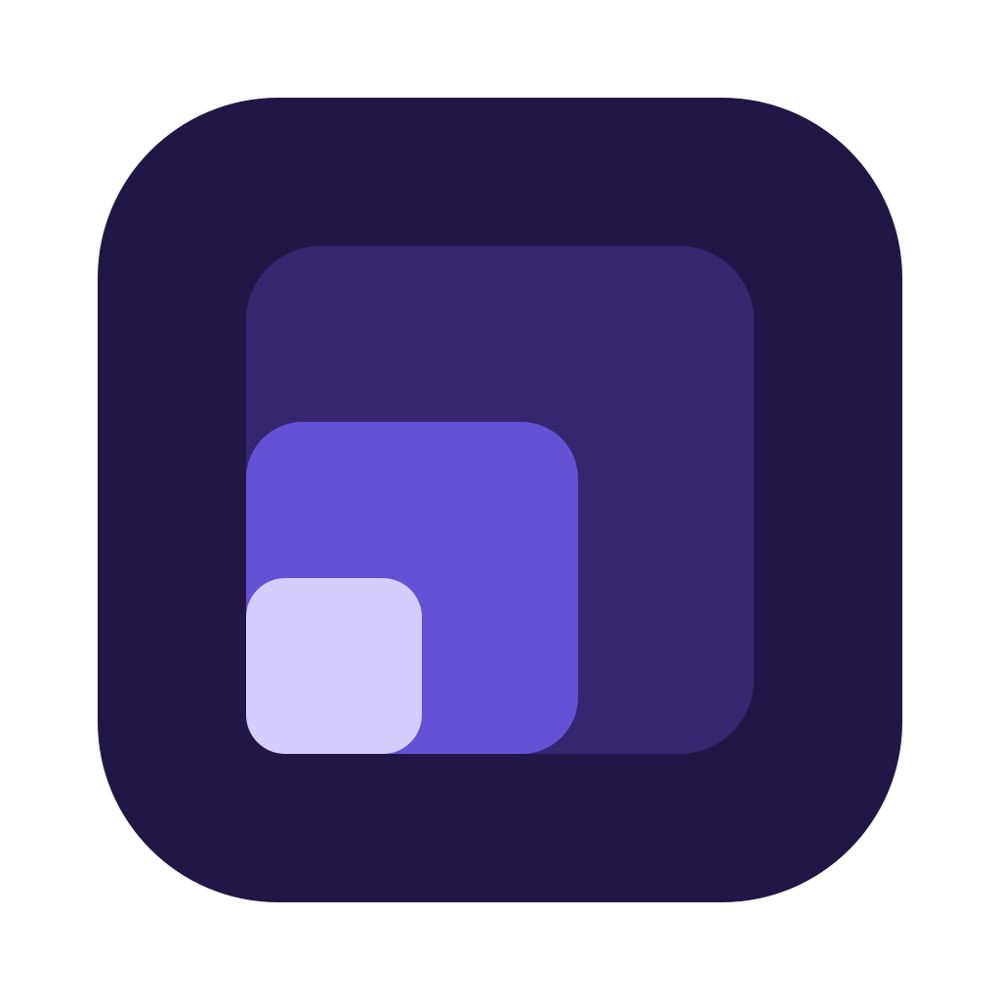

<p align="center"></p>

<h1 align="center">Compact</h1>

<p align="center">A keyboard-first, low-memory browser for macOS, built on WebKit and written in Rust.<br>
It also gives coding agents a browser workspace of their own.</p>

---

Compact keeps your tabs in **workspaces**, keeps only a few of them **live**, and
puts the rest to sleep. Its chrome stays out of sight until you reach for it,
and everything it does is a key away.

It is also a place for **agents** to work. Claude Code, opencode or any MCP
client can open the site it is building in a workspace of its own, read and
screenshot it, see its console and network errors, and take your comments,
pinned to the exact element you mean.

> **v0.1.0 is an early release.** It runs on Apple Silicon Macs only, and it is
> not notarized yet: see [First launch](#first-launch).

## Install

1. Download `Compact-0.1.0-arm64.dmg` from the
   [latest release](https://github.com/tolaniverse/compact/releases/latest).
2. Check it, if you like, against the `.sha256` file published beside it:
   `shasum -a 256 -c Compact-0.1.0-arm64.dmg.sha256`
3. Open the disk image and drag **Compact** to **Applications**.

Needs an Apple Silicon Mac and macOS 11 or later.

### First launch

This build is signed ad hoc, not with an Apple Developer ID, so macOS stops it
the first time:

- **macOS 15 and later:** open Compact once and dismiss the warning, then go to
  **System Settings › Privacy & Security**, scroll down and choose
  **Open Anyway** next to Compact.
- **macOS 14 and earlier:** Control-click Compact in Applications, choose
  **Open**, then **Open** again.

Or clear the quarantine flag from a terminal:

```sh
xattr -dr com.apple.quarantine /Applications/Compact.app
```

You only need to do this once. A notarized build is planned.

## Using it

Everything is reachable from the **command palette (⌘K)**, and every key below
can be remapped in **All settings (⌘⇧,)**.

| Key | Does |
| --- | --- |
| ⌘K | Command palette |
| ⌘L | Address bar |
| ⌘T / ⌘W | New tab / close tab |
| ⌘R | Reload |
| ⌘1–3 | Go to a workspace |
| ⌥Space | Workspace switcher |
| ⌘⇧J | Jump to the latest notification |
| ⌘E | Vertical or horizontal tabs |
| ⌘D | Bookmark the page |
| ⌘, / ⌘⇧, | Quick settings / all settings |
| ? | Every shortcut |
| ⌘\\ | Split view: two workspaces side by side |
| ⌘⌥\\ | Switch sides in split view |
| ⌘⇧R | Review mode, in an agent's workspace |
| ⌘⌥I | Developer tools, in an agent's workspace |

**Memory.** Compact keeps a byte budget of live tabs, sized to the memory your
Mac has free and shrunk under memory pressure. Tabs beyond it hibernate: their
session is saved — 687 bytes per tab, measured — and restored, scroll position
included, when you come back. Whether WebKit then frees the renderer behind a
hibernated tab is still being measured; see [FINDINGS.md](FINDINGS.md).

**What it remembers.** Workspaces, tabs, bookmarks and settings survive a
restart, in `~/Library/Application Support/Compact`. Browsing history does not:
the new-tab page's recent list lasts for the session only.

## Agent workspaces

Add Compact to an agent as an MCP server. For Claude Code:

```sh
claude mcp add compact -- /Applications/Compact.app/Contents/MacOS/compact-mcp
```

Any other MCP client: run `/Applications/Compact.app/Contents/MacOS/compact-mcp`
over stdio. It starts Compact if it is not running.

The first time an agent connects from a project, Compact asks you. Once you
allow it, the agent gets **its own workspace**, marked with a robot and named
after it ("Claude Code's workspace"), with its own cookies and storage, separate
from yours. It can open pages on `localhost` freely; any other site needs your
yes once per session; `file:` and similar URLs are refused.

What the agent can do:

| Tools | |
| --- | --- |
| `open_tab`, `navigate`, `reload`, `close_tab`, `list_tabs` | Drive its own tabs |
| `snapshot`, `screenshot` | Read a page as an outline with element refs, or look at it |
| `console_logs`, `network_requests`, `performance` | Debug what the page did |
| `request_review`, `wait_for_feedback`, `get_comments` | Ask you to look, and get your comments |
| `reply_to_comment`, `mark_addressed` | Answer, and hand a fix back for you to check |
| `show_in_devtools` | Point you at a console or network entry |

**Review mode (⌘⇧R).** Point at anything on the agent's page and pin a
comment to it, or drag out an empty area to say what belongs there. Each
comment reaches the agent with the element's selector, text, role, styles, a
cropped screenshot and, in React, Vue and Svelte dev builds, the component and
source file behind it. When the agent marks a comment addressed, the page
reloads and the pin pulses until you resolve it or reply.

**Developer tools (⌘⌥I).** Console, network and performance, docked beside
the page — the same data the agent reads, with **Send** on every row to hand
an entry to the agent.

Take control of an agent's workspace from the palette at any time; it waits
until you hand it back. Revoke an agent's access the same way.

## Building from source

Needs Rust (stable) on an Apple Silicon Mac.

```sh
cargo xtask run          # build, bundle into out/Compact.app and launch
cargo xtask test         # every test
cargo xtask dist         # release build, out/Compact-<version>-arm64.dmg and its checksum
cargo xtask icon         # rebuild the app icon from assets/icon/compact.svg (needs librsvg)
```

`compact --demo` opens the sample workspaces from the design canvas and saves
nothing. `COMPACT_STATE_DIR` points Compact, and `compact-mcp`, at another
state folder.

| Crate | |
| --- | --- |
| `compact-core` | The whole app as plain data and rules: workspaces, tabs, the live-tab budget, settings, agents, review comments. No dependencies, no I/O; the shell calls `App::apply(action)` and carries out the effects it returns. |
| `compact-engine` | The `TabEngine` trait and its WebKit implementation: hibernation, profiles, capture, inspection, the review overlay and the developer tools page. |
| `compact-ui` | The AppKit shell and its CALayer chrome. |
| `compact-agent`, `compact-mcp` | The agent socket and its wire format; the MCP server agents run. |
| `compact-mem`, `memspike` | Memory measurement and the guarded harness behind [FINDINGS.md](FINDINGS.md). |
| `xtask` | Build, bundle, package and icon tasks. |

## License

Compact is licensed under either of

- Apache License, Version 2.0 ([LICENSE-APACHE](LICENSE-APACHE))
- MIT license ([LICENSE-MIT](LICENSE-MIT))

at your option.

Unless you explicitly state otherwise, any contribution intentionally submitted
for inclusion in the work by you, as defined in the Apache-2.0 license, shall be
dual licensed as above, without any additional terms or conditions.
